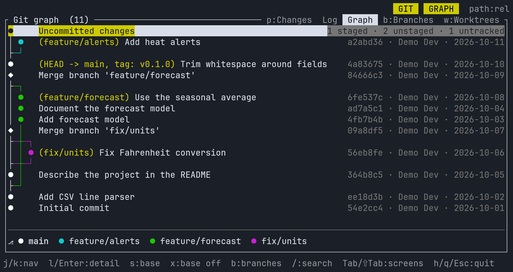
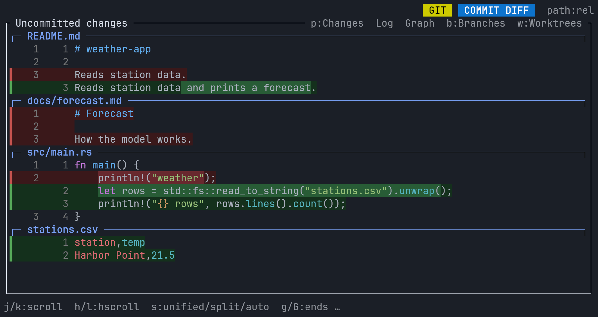

# konoma-vcs

The Git and Jujutsu (jj) screens of [konoma](https://github.com/LESIM-Co-Ltd/konoma), a terminal file browser: changes, log, commit graph, branches or bookmarks, and worktrees.





| Crate | What it is |
|---|---|
| [`konoma-vcs`](crates/konoma-vcs/README.md) | The `git` and `jj` project plugins, and the `konoma-vcs` program that opens the same screens on their own |
| [`konoma-vcs-core`](crates/konoma-vcs-core/README.md) | Library below the screens: git and jj reading behind one trait, commit-graph layout, and a few git write operations |

konoma already includes these screens (press `p`), so konoma users do not need to install anything from here.

## Try it

From a clone of this repository (needs a terminal and `git`):

```sh
cargo run -p konoma-vcs -- .
```

The program starts on the changes screen. `Tab` moves between screens, `?` lists the keys, `q` quits. It can modify the repository you open (stage, discard, commit, branches, worktrees); see [read-only use](crates/konoma-vcs/README.md#configuration).

## Build and test

Rust 1.92 or later.

```sh
cargo build
cargo test
cargo test --no-default-features
```

CI runs on macOS and Ubuntu, with and without default features. On Ubuntu it installs `pkg-config cmake libssl-dev zlib1g-dev` first.

## License

MIT.
