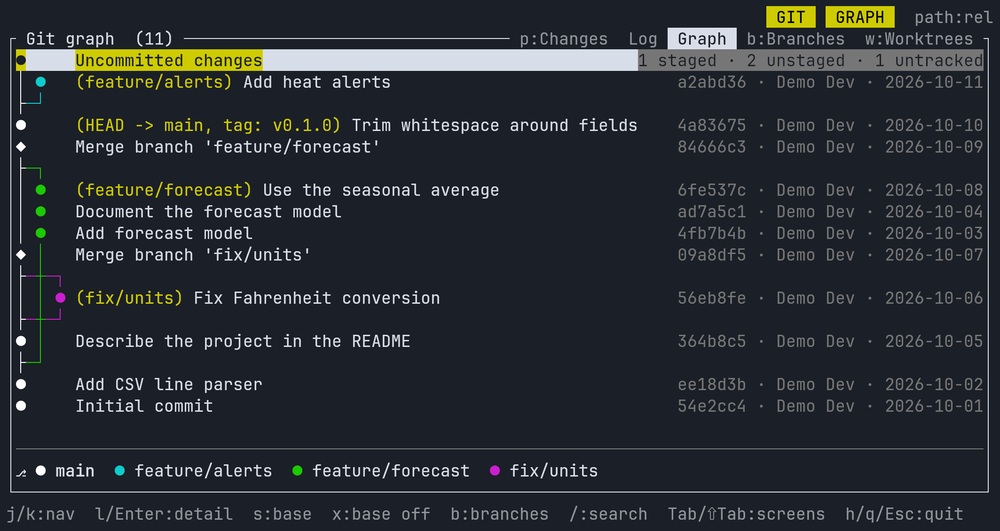
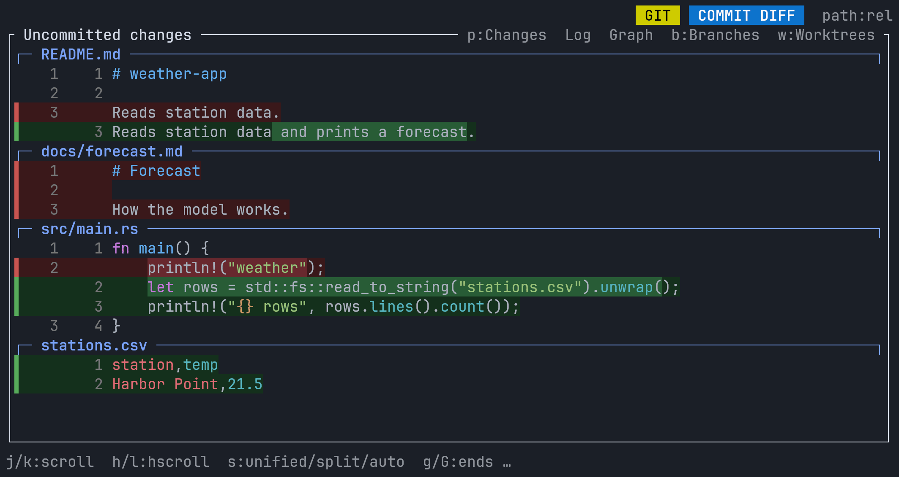

# konoma-vcs-core

Version-control reading for [konoma](https://github.com/LESIM-Co-Ltd/konoma): Git and Jujutsu (jj) behind one trait, commit-graph layout into text rows, and a few Git write operations. It draws no UI and knows nothing about translations or configuration files. The screens are in [`konoma-vcs`](https://github.com/LESIM-Co-Ltd/konoma-vcs/tree/main/crates/konoma-vcs).





## What is in it

- `vcs`: the `Vcs` trait (status, ignored paths, branch, changed files, diffs, log, graph, refs, commit detail), the backends `vcs::Git` and `vcs::Jj`, and free functions of the same names that pick a backend for a directory. `vcs::set_preference` overrides the choice for the whole process.
- `git`: the data types (`FileStatus`, `ChangeEntry`, `DiffLine`, `CommitInfo`, `BranchInfo`, `GraphRow`, ...), Git reads, and the writes `stage`, `unstage`, `stage_all`, `unstage_all`, `discard`, `commit`, `checkout`, `create_branch`, `delete_branch`, `worktree_add`.
- `glyph` and `style`: commit-node glyphs and color/style roles for a graph.

jj has no write operations here apart from taking a snapshot.

## Example

```toml
[dependencies]
konoma-vcs-core = { version = "0.1", features = ["git"] }
```

```rust
use std::path::Path;
use konoma_vcs_core::vcs;

fn main() {
    let root = Path::new(".");
    if let Some(branch) = vcs::branch(root) {
        println!("branch: {branch}");
    }
    for (path, status) in vcs::statuses(root) {
        println!("{} {}", status.marker(), path.display());
    }
    for commit in vcs::log(root, 5) {
        println!("{} {}", commit.short, commit.summary);
    }
}
```

## Behaviour

- Reads do not return errors: outside a repository, on failure, or when the integration is switched off, they return an empty value or `None`. The Git writes return `anyhow::Result`.
- Paths come back absolute, and `statuses` also has entries for directories that contain changes.
- With no preference set, Git answers wherever it can; jj answers otherwise, if there is a `.jj` and a `jj` program.
- Git reading uses both the `git` program and libgit2; writes run the `git` program. `checkout` and `create_branch` use `git switch` (Git 2.23 or later).
- jj is run as the `jj` program. Availability is checked with `jj --version`. Reads pass `--ignore-working-copy`; only the snapshot function writes. So `log`, `graph` and `commit_diff` answer from jj's last snapshot. `statuses` and `changed_files` also check the disk, but go by modification time for files changed since then: a file moved or copied in with an older time is not reported until jj takes a snapshot, and a file jj recorded as changed is still reported after you restore it. `file_diff` reads the file's current bytes from disk.
- A file counts as binary when there is a NUL byte in its first 8000 bytes.
- `log` returns at most the number you ask for. There is no option to cap the size of a diff or of returned file contents, so apply your own limit to untrusted repositories.

## Features

| Feature | Effect |
|---|---|
| (default: none) | the Git and jj integration is compiled out; reads return nothing |
| `git` | libgit2, the `git` program, and the jj backend; re-exports `git2` |
| `test-hooks` | seams for konoma's own tests |

MSRV 1.92. macOS and Linux. MIT license.
