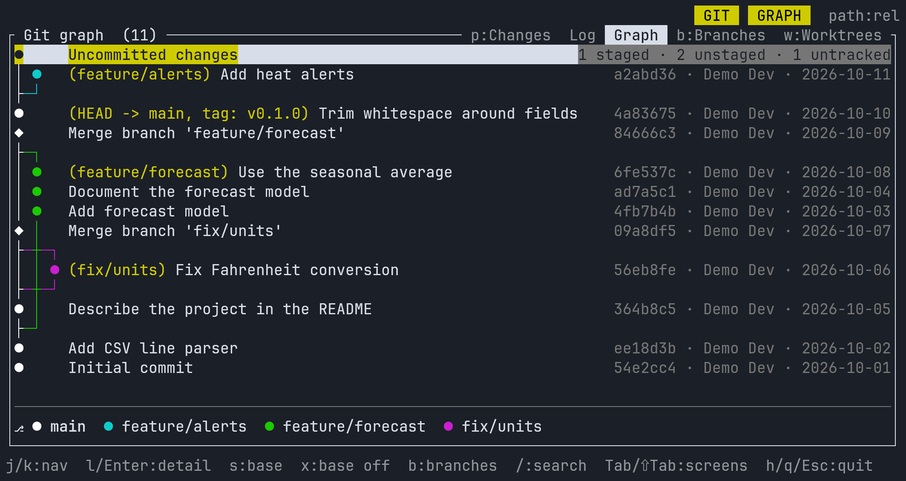
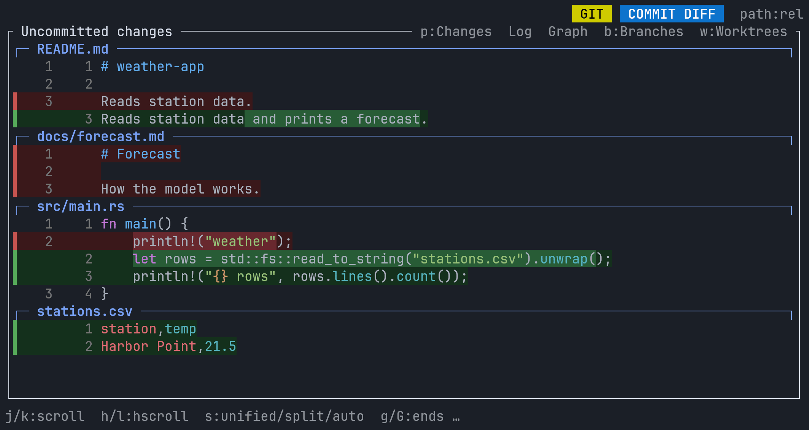

# konoma-vcs

Git and Jujutsu (jj) screens in the terminal: the `git` and `jj` project plugins of [konoma](https://github.com/LESIM-Co-Ltd/konoma), plus a `konoma-vcs` program that runs them on their own.





## What it shows

A directory is a Git project when it or a directory above it has `.git`, and a jj project when it or a directory above it has a `.jj` directory.

| Screen | Git | jj |
|---|---|---|
| Changes | changed files (`●` marks staged), per-file diff, diff of all changes | changed files and diffs against `@-` |
| Log | recent commits (up to 200), commit detail | same |
| Graph | branch graph with an "Uncommitted changes" row, pinnable base, branch picker | revision graph, "all revisions" toggle |
| Branches / Bookmarks | check out, create, delete, copy name | list and copy name (not with `.git` alongside; see [Limits](#limits)) |
| Worktrees | switch, create, diff since base | none |

## In konoma

Both plugins are built into konoma: `p` opens the screens, so there is nothing to install. The standalone program is for using them without konoma. Files opened from these screens are shown by the standard file preview plugins.

## Install

```sh
cargo install konoma-vcs
```

There are no prebuilt binaries on GitHub releases.

## Command line

```text
konoma-vcs [directory]                     open the screens (default: current directory)
konoma-vcs --plugin <git|jj> [directory]   open only that system
konoma-vcs --version                       print plugin ids and versions
konoma-vcs --help | -h                     print help
konoma-vcs --plugin <git|jj> --manifest    print what the plugin declares (JSON)
konoma-vcs --plugin <git|jj> --serve       serve a konoma host on stdin/stdout
```

`--help` prints the text shared by all konoma plugin programs and does not mention the directory form.

Exit codes seen: `2` for bad arguments, a missing path, a file instead of a directory, or no project there; `1` when the project cannot be opened or stdin/stdout is not a terminal.

In a repository that has both `.git` and `.jj`, a dialog asks which one to open.

## Keys

`?` shows the keys of the current screen.

| Where | Keys |
|---|---|
| All lists | `j`/`k` move, `g`/`G` top/bottom, `l`/`Enter` open, `/` filter, `r` reload, `Tab`/`Shift-Tab` next/previous screen, `h`/`Esc`/`q` back or quit, `Q` quit |
| Changes | `d` diff of all changes, `b` branches, `!` external tool |
| Changes (Git) | `s`/`S` stage / stage all, `u`/`U` unstage / unstage all, `x` discard (asks), `c` commit, `w` worktrees |
| Changes (jj) | `s` let jj snapshot the working copy (asks) |
| File diff | `R` cycle source / rendered / preview, `n`/`N` next/previous change, `Ctrl-n`/`Ctrl-p` next/previous file, `x` discard (Git), `e` editor, `o` open in another app |
| Commit detail, diff of all changes | `s` unified / split / auto, `h`/`l`/`0`/`$` horizontal scroll |
| Log, graph, commit detail | `y` then `s` short hash (jj: change id), `h` full hash (jj: commit id), `t` subject, `m` message, `a` author, `d` date |
| Graph (Git) | `s` pin the selected commit's branch as base, `x` clear it, `b` choose branches |
| Graph (jj) | `a` every revision |
| Branch picker (Git) | `x` toggle, `J`/`K` reorder, `a` all, `c` current only, `Enter` apply |
| Branches | `y` `n` copy name; Git only: `Enter` check out, `c` new, `d` delete (`y` = `git branch -d`, `!` = `-D`) |
| Worktrees | `Enter` switch, `c` new (new or existing branch), `d` diff since base |

## Configuration

The program reads konoma's configuration file: `$XDG_CONFIG_HOME/konoma/config.toml`, otherwise `~/.config/konoma/config.toml`. A file that cannot be parsed is ignored with a message and the defaults apply.

```toml
[plugins.git]
read_only = false          # true: no write operations
worktree_dir = "../"       # where new worktrees go, relative to the main worktree
graph_max_branches = 12    # 0 = unlimited
graph_base_branches = []
commit_meta_align = "right"  # or "inline"

[plugins.jj]
read_only = false          # separate from the git setting
confirm_sync = true
```

Both tables also accept `enabled = false` and `path_style = "relative" | "home" | "full"`. Keys are rebound under `[keys.git]` and `[keys.jj]`.

Shared settings that also apply: `[git] diff` (`unified`, `split` or `auto`) and `tool` (default `lazygit`), `[jj] tool` (default `lazyjj`), `[ui] lang`, `icons`, `path_style`, `[ui.theme]`, `[external] git` and `git_tool`.

`[project] vcs`, which konoma uses to pick a system, has no effect here: a repository with both still shows the dialog.

## Requirements

- A terminal.
- `git` for Git projects. Branch checkout and creation use `git switch` (Git 2.23 or later).
- `jj` for jj projects. Tried with jj 0.44.0.
- Optional: `lazygit` / `lazyjj` for `!`.
- macOS or Linux.

## Limits

- jj repositories are read, not edited. The one write is the confirmed snapshot (`s` on Changes); other reads pass `--ignore-working-copy`.
- In jj, commit detail and the diff of all changes (`d`) show jj's last snapshot. The Changes list also checks the disk, but can differ from it until jj takes a new snapshot:
  - Shown: files edited, created or deleted since the snapshot. A file jj had recorded as added leaves the list when you delete it.
  - Not shown: a file moved in, renamed with `mv`, or overwritten with `cp -p`, that keeps a modification time older than the snapshot. A renamed file appears only as the old name, deleted.
  - Still shown: a file jj recorded as changed that you have since restored.
- In jj, the graph cannot be narrowed to chosen bookmarks with the picker (`b` on the graph): the selection does not change which revisions are listed.
- In a repository with both `.git` and `.jj` opened as jj, the Bookmarks screen lists Git branches, not jj bookmarks.
- No merge, rebase, fetch, pull or push.
- The log lists up to 200 commits and the graph up to 400.
- In a repository with both `.git` and `.jj`, if `jj` is not available the program fails to open, even though Git would work. Set `[plugins.jj] enabled = false` to open it as Git.

## Features

Default: `git` and `app`. The `konoma-vcs` binary needs `app`. Without `git`, no write operations are declared and the program cannot open a repository.

## License

MIT.
